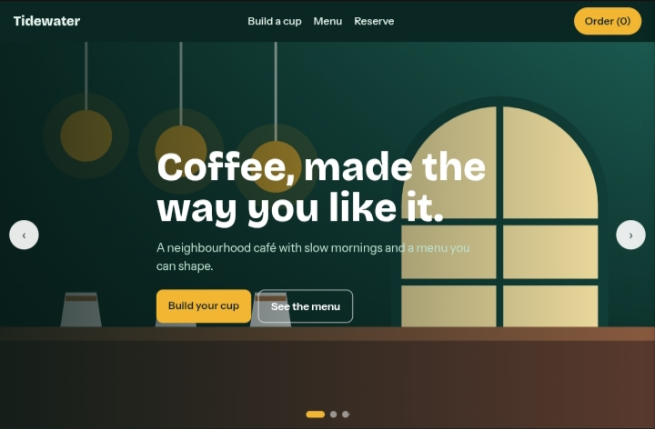
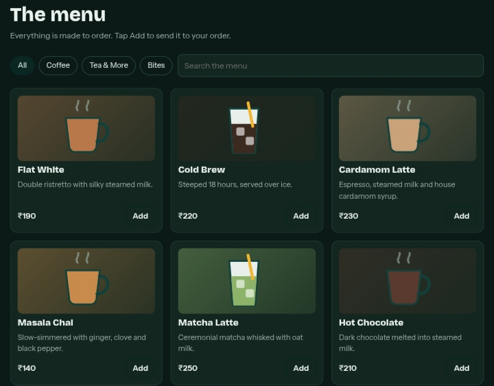
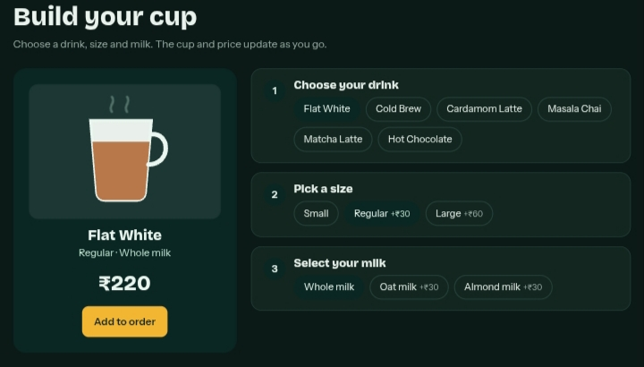

☕ Tidewater Cafe

A modern, elegant, and responsive cafe website built with React and Vite. Tidewater Cafe brings a clean user interface and a smooth browsing experience together to create a welcoming digital presence for a cafe.

🌐 Live Demo: "tidewater-cafe.vercel.app" (https://tidewater-cafe.vercel.app/)

---

✨ Features

- Modern UI: Clean and visually appealing website design.
- Responsive Design: Optimized for desktop, tablet, and mobile devices.
- React Components: Component-based architecture for maintainable code.
- Fast Performance: Powered by Vite for a fast development experience and optimized production builds.
- Modern Styling: Custom CSS for the website's visual appearance.
- Smooth Experience: Simple and intuitive website navigation.

---

🛠️ Tech Stack

Technology| Purpose
React 18| Frontend UI development
Vite 6| Development and build tool
JavaScript| Application logic
CSS3| Styling and responsive layouts
Vercel| Deployment and hosting

---

## 📸 Screenshots

### Homepage

### Menu

### Build a Cup

🚀 Getting Started

Follow these steps to run the project locally.

Prerequisites

Make sure you have the following installed:

- "Node.js" (https://nodejs.org/) (20 or newer)
- npm

1. Clone the Repository

git clone YOUR_GITHUB_REPOSITORY_URL

2. Navigate to the Project Directory

cd tidewater-cafe

3. Install Dependencies

npm install

4. Start the Development Server

npm run dev

Open the local URL displayed in your terminal to view the website.

---

📦 Available Scripts

Command| Description
"npm run dev"| Starts the development server
"npm run build"| Creates an optimized production build
"npm run preview"| Previews the production build locally

---

📁 Project Structure

tidewater-cafe/
│
├── public/              # Static assets
├── src/                 # React application source code
│
├── index.html           # Main HTML entry point
├── package.json         # Project dependencies and scripts
├── package-lock.json    # Dependency lock file
├── vite.config.js       # Vite configuration
│
└── README.md            # Project documentation

---

🌍 Deployment

The project is deployed using Vercel.

Live Website: https://tidewater-cafe.vercel.app/

---

🤝 Contributing

Contributions, suggestions, and improvements are welcome!

1. Fork the repository.
2. Create a new branch.
3. Make your changes.
4. Submit a pull request.

---

📄 License

All rights reserved.

---

  Made with ❤️ using React and Vite

